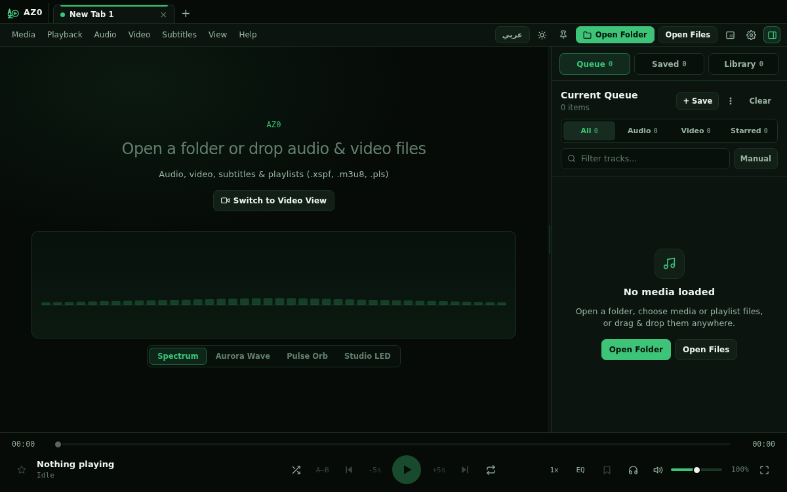
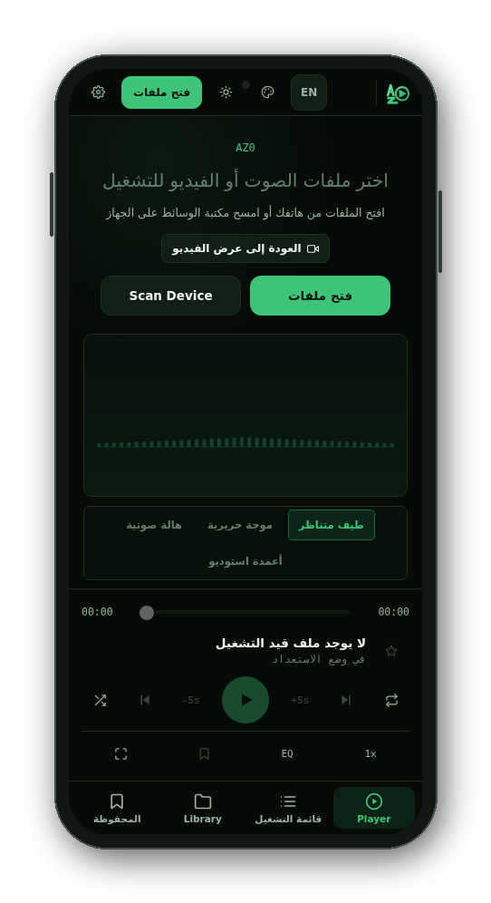
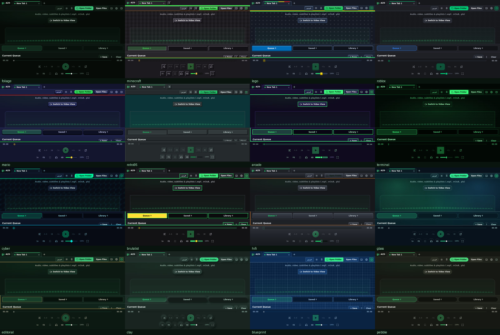

<div align="center">
  
  <h1>AZ0</h1>
  <p><strong>مشغّل الصوت والفيديو المحلي بتاعك — خفيف، سريع، وبيشتغل من غير نت</strong><br/>
  A lightweight local audio &amp; video player for Windows and Android</p>
  <p>
    
    
    
    
    
  </p>
  <p>
    <a href="../../releases/latest"><strong>⬇️ تحميل أحدث إصدار · Download Latest Release</strong></a>
  </p>
</div>

<p align="center">
  
  
</p>

<p align="center">
  
</p>

---

<div dir="rtl" align="right">

## 🇪🇬 العربية

### إيه هو AZ0؟
مشغّل محلي لملفات الصوت والفيديو على ويندوز وأندرويد. يفتح الملفات والمجلدات وقوائم التشغيل من غير ما يحتاج نت ولا حسابات، وملفاتك بتفضل على جهازك — مفيش حاجة بتترفع لأي سيرفر.

### اللي بيميزه
- **تبويبات ونوافذ مستقلة** زي المتصفح: كل تبويب مشغّل لوحده بصوته وقائمته، والبرنامج بيرجّع آخر جلسة زي ما كانت بالظبط
- **قوائم تشغيل جدّية:** سحب وإفلات، كليك يمين، "التالي في القائمة"، حفظ وتصدير `.XSPF` / `.M3U8` / `.PLS`
- **16 ثيم كاملين** بداكن وفاتح (32 شكل)، منهم ماينكرافت وليجو وروبلوكس وأركيد وويندوز 95 الكلاسيكي — بتتبدل من قائمة العرض في ثانية
- **مكتبة وسائط** للمجلدات اللي انت بتختارها بس، مع بحث وفلترة وفرز بالاسم أو التاريخ أو المدة، وسجل مشاهدة بيكمّل من آخر نقطة وقفت عندها
- **تحكم حقيقي في الصوت:** شريط صوت من 0 لـ 200%، معادل 5 نطاقات، وتوجيه الصوت لكل تبويب أو نافذة لوحدها
- **مشغّل مصغّر** يفضل فوق أي نافذة، وبيتحفظ مكانه وحجمه بين المرات
- **ترجمة تلقائية** بتتكشف لوحدها مع تخصيص الخط والتوقيت، وتحكم كامل في الفيديو لحد التنقل إطار بإطار
- **بث للتلفزيون والشاشات** على شبكتك المحلية (DLNA / Wi-Fi) محمي برمز أمان
- **عربي وإنجليزي** بواجهة كاملة الاتجاهين، والخطوط مدمجة جوه البرنامج فبتشتغل أوفلاين
- **تحديثات آمنة:** كل إصدار بيتأكد من بصمة SHA-256 وتوقيع Minisign قبل ما يتثبت، وأي إصدار من غير توقيع بيترفض تلقائياً

### التحميل
- **[تحميل أحدث إصدار](../../releases/latest)** — حزمة ويندوز متاحة الآن (مثبّت Setup أو نسخة محمولة Portable)

</div>

---

## 🇬🇧 English

AZ0 is a local audio &amp; video player for Windows and Android. It opens files, folders and playlists fully offline — no accounts, no uploads, your media stays on your device.

- Browser-style multi-tab workspace with independent windows and exact session resume
- Serious playlists: drag-and-drop, right-click actions, Up Next, `.XSPF` / `.M3U8` / `.PLS` export
- 16 full themes in dark and light, switchable in one click from the View menu
- Media library for the folders you choose, with search, filters, sorting and resumable watch history
- Real 0–200% volume, 5-band EQ, and per-tab audio output routing
- Always-on-top Mini Player, auto-detected subtitles, frame-accurate video controls
- Token-protected local-network casting to TVs and screens
- Full Arabic/English UI with offline bundled fonts
- Fail-closed updates: every release is verified against SHA-256 sums and a Minisign signature, and unsigned builds are refused automatically

**[Download the latest release](../../releases/latest)** — Windows packages (Setup installer or Portable) are available now.

### Updater Signing & Key Handling
The desktop updater enforces **fail-closed verification**: every release installer must provide both a valid SHA-256 checksum (`SHA256SUMS.txt` or GitHub asset digest) and a valid **Minisign** Ed25519 signature (`.minisig`) whose trusted comment binds the exact release version, filename, and SHA-256 digest (`aaz-player|version=<ver>|file=<name>|sha256=<hash>`) to prevent replay or downgrade attacks. Unsigned releases or builds without a configured public key are refused automatically.

To enable signed releases in your repository:
1. Generate a Minisign keypair locally:
   ```bash
   minisign -G -p aaz-updater.pub -s aaz-updater.key
   ```
2. Keep `aaz-updater.key` private (never commit it). Add these GitHub Actions Secrets:
   - `AAZ_UPDATER_SIGNING_KEY`: full contents of `aaz-updater.key`
   - `AAZ_UPDATER_SIGNING_KEY_PASSWORD`: passphrase used when generating the key (leave empty if unprotected)
3. Add the base64 public key line (from `aaz-updater.pub`, starting with `RW...`) as a GitHub Repository Variable or Secret named `AAZ_UPDATER_PUBLIC_KEY`.
4. `.github/workflows/release.yml` fails closed on stable releases if either `AAZ_UPDATER_SIGNING_KEY` or `AAZ_UPDATER_PUBLIC_KEY` is missing. It never publishes into an existing release: both push and manual `workflow_dispatch` runs refuse to touch a tag that already has a release, so previews can never overwrite or append to a published version.
5. **Key rotation**: publish a transitional release signed with the old key whose binary embeds the new public key before retiring the old secret key.

### Project Structure
- `index.html` — Semantic application shell and modals
- `css/styles.css`, `css/themes.css` & `public/fonts/` — 16-theme Dark & Light stylesheets and locally bundled WOFF2 fonts
- `js/core/` — Hardened cross-window messaging, Tauri desktop bridge, event bus
- `js/modules/` — Versioned storage (`v4`), themes catalog, playlist I/O, watch history, media library, shortcuts, settings, window layout
- `js/ui/` & `js/app/` — Multi-tab workspace shell, Phase 3 feature controller, core playback engine
- `desktop/src-tauri/` — Native Rust + Tauri v2 backend (media protocol, Cast/DLNA, Windows taskbar thumbnail toolbar, fail-closed Minisign/SHA-256 updater, window management)
- `tests/` — Automated Node.js test suite (`node tests/run-tests.cjs`)

---

<div align="center">
  <sub>AZ0 — MIT License</sub>
</div>
